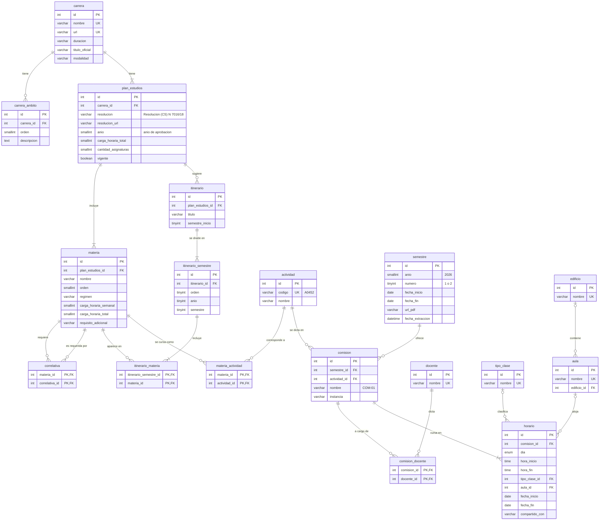

# Base de datos · rutas-cursada

Modelo de datos en MySQL para guardar las carreras de la UNGS, sus planes de estudio y la oferta de comisiones de cada semestre. A partir de esto se calculan las rutas para terminar una carrera.

## Índice

1. [Visión general](#visión-general)
2. [DER](#der)
3. [Bloque 1 · Carreras y planes de estudio](#bloque-1--carreras-y-planes-de-estudio)
4. [Bloque 2 · Oferta por semestre](#bloque-2--oferta-por-semestre)
5. [El puente entre los dos bloques](#el-puente-entre-los-dos-bloques)
6. [Decisiones de diseño](#decisiones-de-diseño)
7. [Consultas de ejemplo](#consultas-de-ejemplo)

---

## Visión general

La base tiene dos bloques que salen de fuentes distintas y cambian con ritmos distintos:

| Bloque | Qué guarda | De dónde sale | Cada cuánto cambia |
|---|---|---|---|
| **Carreras y planes** | Carreras, planes, materias, correlativas e itinerarios | `carreras.json` (`extractor-carreras.py`) | Rara vez: cuando se aprueba un plan nuevo |
| **Oferta por semestre** | Comisiones, horarios, aulas y docentes | `periodo.xlsx` (`extractor-periodo.py`) | Cada semestre |

Los une una sola tabla, `materia_actividad`, que dice qué actividad de la oferta corresponde a cada materia del plan.

```
carrera ─► plan_estudios ─► materia ◄──── materia_actividad ────► actividad ◄─ comision ◄─ semestre
                               │                                                  │
                     correlativas e itinerario                         horarios, aulas y docentes
```

---

## DER



### Cómo leer las relaciones

| Símbolo | Significa |
|---|---|
| `\|\|` | exactamente uno |
| `\|o` | cero o uno |
| `\|{` | uno o más |
| `o{` | cero o más |

Por ejemplo, `plan_estudios ||--|{ materia` se lee: *cada materia pertenece a exactamente un plan, y cada plan tiene una o más materias*.

En las tablas, **PK** es la clave primaria, **FK** una clave foránea y **UK** un valor que no se puede repetir.

---

## Bloque 1 · Carreras y planes de estudio

### `carrera`
Una carrera de la universidad, tal como aparece en el listado del sitio: nombre, URL, duración, título y modalidad.

- Tiene **cero o más** ámbitos de desempeño (`carrera_ambito`).
- Tiene **uno o más** planes de estudio (`plan_estudios`).

### `carrera_ambito`
Cada ítem de la lista "Ámbitos de desempeño" de la carrera. Va en una tabla aparte porque es una lista de longitud variable; `orden` conserva la posición en la que aparece en la página.

### `plan_estudios`
El plan aprobado por una resolución (por ejemplo, *Resolución (CS) Nº 7016/18*). Agrupa las materias y el itinerario de esa versión de la carrera.

- Pertenece a **una** carrera.
- Tiene **una o más** materias y **cero o más** itinerarios.
- `vigente` indica cuál es el plan actual. Por ahora se guarda solo el vigente, pero el modelo admite varios planes por carrera si en el futuro se quiere conservar el historial.

### `materia`
Una materia **tal como figura en un plan**: nombre, régimen (semestral o anual) y carga horaria.

- Pertenece a **un** plan. Si dos carreras tienen "Programación I", son dos filas distintas, porque en cada plan puede tener otras correlativas o cargas horarias.
- `requisito_adicional` guarda las correlativas que no son una materia, como *"14 (catorce) materias de la carrera"*.

### `correlativa`
Relación de una materia consigo misma (muchos a muchos): para cursar `materia_id` hay que tener `correlativa_id`.

- Ejemplo: *Programación II* requiere *Programación I* e *Introducción a la Matemática* → dos filas.
- Las dos materias pertenecen al mismo plan, y una materia no puede ser correlativa de sí misma.

### `itinerario`, `itinerario_semestre` e `itinerario_materia`
El itinerario es la **recomendación de la carrera** sobre en qué orden cursar las materias. La UNGS publica uno por cada forma de empezar (en el primer o en el segundo semestre del año).

- `itinerario`: cada secuencia sugerida, con su título y el semestre de inicio.
- `itinerario_semestre`: cada paso de la secuencia, con su posición (`orden`), el año de la carrera y si es primer o segundo semestre.
- `itinerario_materia`: qué materias van en cada paso. Una materia anual aparece en dos pasos seguidos.

> **¿Por qué el itinerario depende del plan y no de la carrera?**
> Porque ordena las materias de **un plan en particular**. Si la universidad aprueba un plan nuevo, las materias y el orden recomendado cambian con él. `itinerario_materia` apunta a `materia`, y cada materia pertenece a un plan: colgando el itinerario del plan, la base garantiza que no se mezclen materias de planes distintos.
>
> Mientras se guarde un solo plan por carrera, el resultado es el mismo que colgarlo de la carrera: el itinerario de la carrera es el de su plan vigente, a un solo *join* de distancia.
>
> **Si la página actualiza el plan pero no el itinerario**, el cargador vincula cada materia del itinerario por nombre con las materias del plan vigente. Las que ya no existen quedan sin vincular y se informan como advertencia. Si muchas materias dejan de encontrarse, es señal de que el itinerario publicado está desactualizado.

---

## Bloque 2 · Oferta por semestre

### `semestre`
Un semestre lectivo del calendario (por ejemplo, 2026 · 2), con sus fechas y el PDF de comisiones del que se extrajo la oferta.

- Tiene **cero o más** comisiones. Cada semestre se carga sin pisar los anteriores, así queda el historial de ofertas.
- No confundir con `itinerario_semestre`, que es una posición dentro de la carrera ("año 3, primer semestre") y no una fecha del calendario.

### `actividad`
El catálogo de actividades de la universidad, identificadas por su código (`A0452`). No depende de la carrera ni del semestre: la misma actividad se ofrece semestre tras semestre y puede servir a varias carreras.

### `comision`
Un curso concreto de una actividad en un semestre: *A0452 · COM-01 · 2026-2*.

- Pertenece a **un** semestre y a **una** actividad.
- `nombre` guarda el texto completo porque no todas siguen el formato `COM-01`: también hay `COM-02 (BOLIVAR)`, `COM-15 VT` y `COM 01`.
- `instancia`: *Regularidad* o *Regularidad/Promoción*.

### `docente` y `comision_docente`
Una comisión puede tener varios docentes y un docente dicta varias comisiones (muchos a muchos). Cada docente se guarda una sola vez, con el nombre como figura en el PDF ("Apellido Nombre").

### `horario`
Cada fila del PDF de comisiones: un día y una franja horaria de una comisión, en un aula.

- Una comisión tiene **uno o más** horarios. Lo habitual es dos días presenciales y, a veces, una parte virtual.
- **Clase virtual asincrónica** (`VT ASINC`): día, horas y aula quedan vacíos (`NULL`) y el tipo de clase es "VT ASINC".
- **Sin definir**: todos esos campos quedan vacíos.
- Una comisión puede tener dos filas con el mismo día y horario en aulas distintas (por ejemplo, laboratorios de física que usan dos salas a la vez).
- `fecha_inicio` y `fecha_fin` van en cada fila porque en el PDF pueden variar dentro de una misma comisión.
- `compartido_con` guarda el texto original (`A0025 COM-02 | A0025 COM-01`). No se convierte en relación porque algunas de las comisiones que menciona no aparecen en el PDF.

### `aula`, `edificio` y `tipo_clase`
Catálogos para no repetir texto en cada horario y poder consultar, por ejemplo, la ocupación de un aula. Cada aula pertenece a un edificio (*AULA 7278* → *MODULO VIID E3*).

---

## El puente entre los dos bloques

### `materia_actividad`
Une una materia del plan con la actividad del catálogo que la cumple.

- Lo normal es **una actividad por materia**: *Programación III* → *A0452*.
- Es muchos a muchos porque hay excepciones. *Laboratorio Interdisciplinario* se cumple con cualquiera de varias actividades (*Capacidades Emprendedoras*, *Diagnóstico Ambiental*, etc.), y una misma actividad puede servir a materias de distintas carreras.
- Se completa vinculando por nombre: la base compara sin distinguir mayúsculas ni acentos, así *"Álgebra Lineal"* del plan coincide con *"ÁLGEBRA LINEAL"* de la oferta.

Con esta tabla se responde la pregunta central del proyecto: **¿qué comisiones hay este semestre para las materias que me faltan?**

---

## Decisiones de diseño

| Decisión | Motivo |
|---|---|
| El itinerario depende del plan | Ordena las materias de un plan concreto; evita mezclar planes. |
| Materias por plan, no globales | La misma materia puede tener distintas correlativas o cargas en cada plan. |
| `actividad` separada de `materia` | La oferta usa códigos (`A0452`) y el plan usa nombres; además, una actividad sirve a varias carreras. |
| Semestres acumulables | Cargar un semestre nuevo no borra los anteriores. |
| Nombre de comisión como texto | Hay formatos irregulares (`COM-02 (BOLIVAR)`, `COM 01`). |
| `compartido_con` como texto | Hace referencia a comisiones que no siempre existen en el PDF. |
| Virtuales con día y hora en `NULL` | "VT ASINC" no es un día ni un horario. |
| Codificación `utf8mb4` sin distinción de acentos | Los nombres del plan y de la oferta difieren en mayúsculas y tildes. |

---

## Consultas de ejemplo

**Correlativas de una materia** (qué necesito para cursar *Bases de Datos I*):

```sql
SELECT req.nombre
FROM materia m
JOIN correlativa c   ON c.materia_id = m.id
JOIN materia req     ON req.id = c.correlativa_id
WHERE m.nombre = 'Bases de Datos I';
```

**Qué materias habilita aprobar una materia** (sentido inverso):

```sql
SELECT m.nombre
FROM materia req
JOIN correlativa c ON c.correlativa_id = req.id
JOIN materia m     ON m.id = c.materia_id
WHERE req.nombre = 'Programación III';
```

**Itinerario del plan vigente de una carrera:**

```sql
SELECT i.titulo, s.orden, s.anio, s.semestre, m.nombre AS materia
FROM carrera ca
JOIN plan_estudios p        ON p.carrera_id = ca.id AND p.vigente
JOIN itinerario i           ON i.plan_estudios_id = p.id
JOIN itinerario_semestre s  ON s.itinerario_id = i.id
JOIN itinerario_materia im  ON im.itinerario_semestre_id = s.id
JOIN materia m              ON m.id = im.materia_id
WHERE ca.nombre = 'Licenciatura en Sistemas'
ORDER BY i.id, s.orden, m.nombre;
```

**Comisiones y horarios de una materia en un semestre:**

```sql
SELECT a.codigo, co.nombre AS comision, h.dia, h.hora_inicio, h.hora_fin,
       t.nombre AS tipo, au.nombre AS aula, e.nombre AS edificio
FROM materia m
JOIN materia_actividad ma ON ma.materia_id = m.id
JOIN actividad a          ON a.id = ma.actividad_id
JOIN comision co          ON co.actividad_id = a.id
JOIN semestre se          ON se.id = co.semestre_id AND se.anio = 2026 AND se.numero = 2
JOIN horario h            ON h.comision_id = co.id
LEFT JOIN tipo_clase t    ON t.id = h.tipo_clase_id
LEFT JOIN aula au         ON au.id = h.aula_id
LEFT JOIN edificio e      ON e.id = au.edificio_id
WHERE m.nombre = 'Programación III'
ORDER BY co.nombre, h.dia, h.hora_inicio;
```